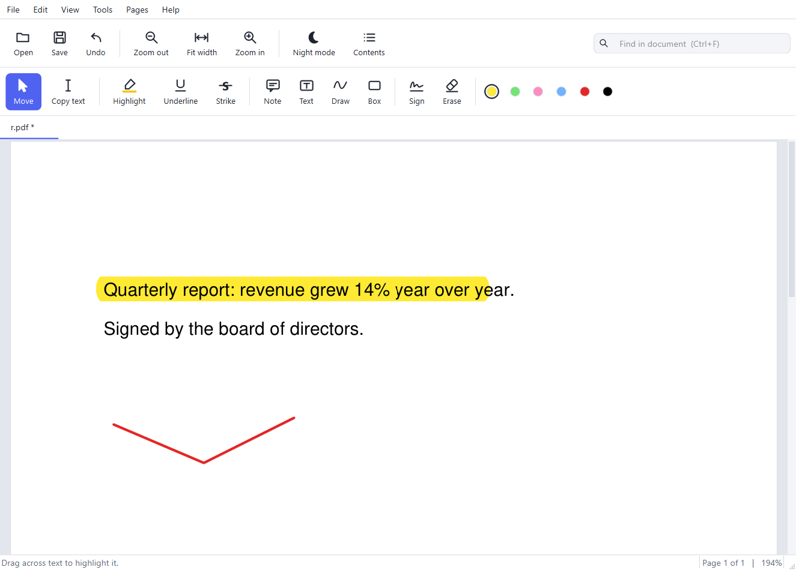
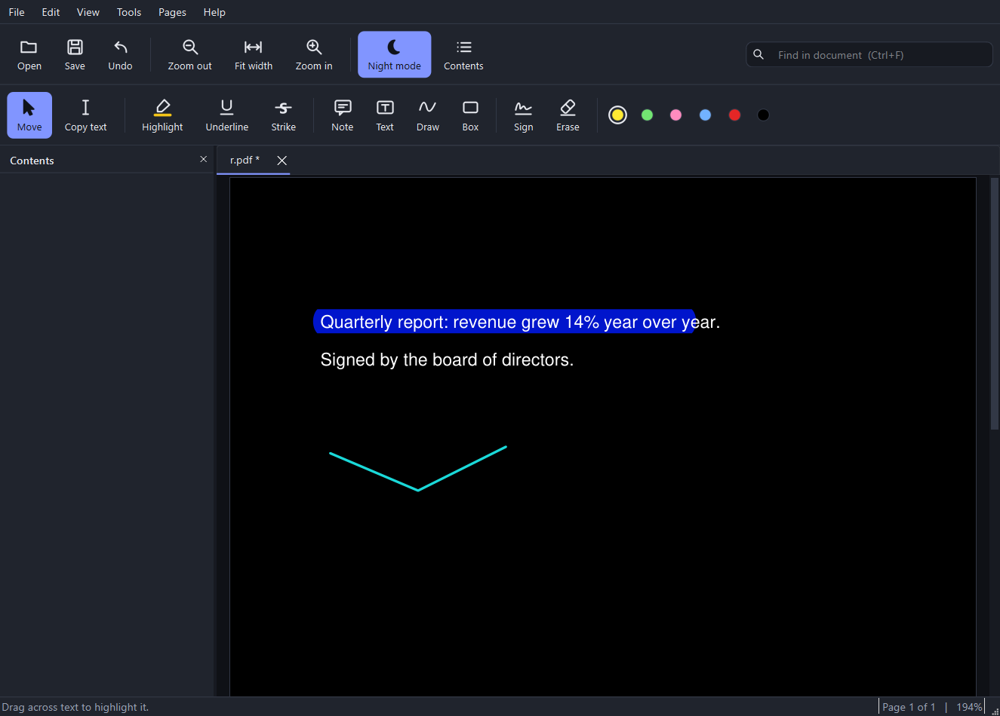

# PDFKit

A fast, light desktop reader and markup tool for PDFs, e-books and images. Windows-first, built with Python, [PySide6](https://doc.qt.io/qtforpython-6/) and [PyMuPDF](https://pymupdf.readthedocs.io/).



## Features

- **Reads** PDF, EPUB, MOBI, FB2, XPS, CBZ, SVG, TXT and common image formats, in tabs.
- **Snappy.** One canvas draws only the pages on screen. Zoom redraws in a few milliseconds, and a 689-page EPUB opens and scrolls without lag.
- **Books:** adjustable text size, contents panel (`F9`), arrow keys turn pages, and it remembers your page and text size per file.
- **Mark up PDFs:** highlight, underline, strike-through, notes, text boxes, freehand drawing, boxes, a drawn or imported signature, erase, and undo. `Ctrl+S` saves into the same file.
- **Copy text**, search with highlighted hits, night mode, and a clean light/dark theme.
- **Page tools:** merge, split, extract, delete, rotate, reorder and compress. These work on any supported format and save a PDF.
- Keyboard-friendly: every action is in the menus with a shortcut (`F1` lists them) and has a tooltip.



## Run from source

```bash
pip install -r requirements.txt
python pdfkit.py [file ...]
```

Needs Python 3.10 or newer.

## Build a Windows app

```powershell
pip install -r requirements-dev.txt
./build.ps1          # produces dist\PDFKit\PDFKit.exe
```

## Tests

```bash
pip install -r requirements-dev.txt
pytest
```

## Known limitations

- Annotating needs a PDF. For an EPUB or other format, use *File > Convert to PDF* first.
- It marks up PDFs but does not edit the existing text inside them.
- Night mode inverts the page, so annotation colours shift (a yellow highlight looks blue).
- Only tested on Windows 11. It has not been tested with a screen reader.

## Contributing

Pull requests and issues are welcome. See [CONTRIBUTING.md](CONTRIBUTING.md).

## License

[AGPL-3.0](LICENSE). PDFKit uses PyMuPDF, which is AGPL-3.0, so PDFKit is released under the same terms.
